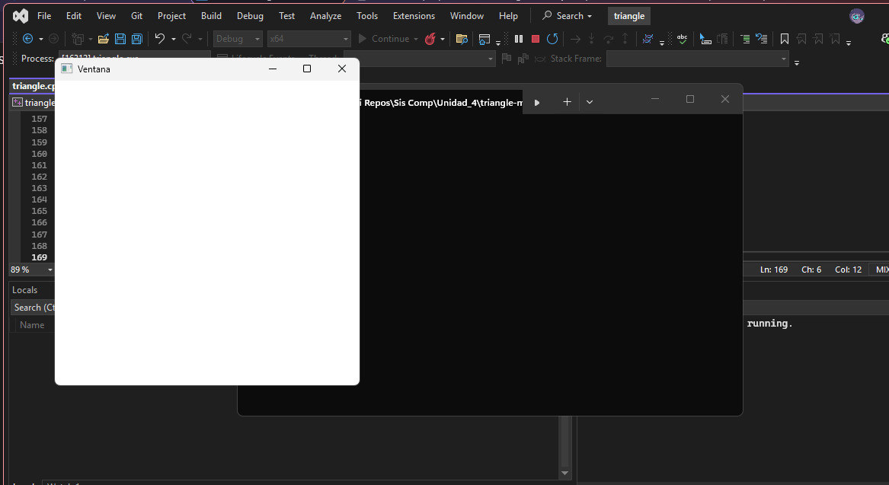
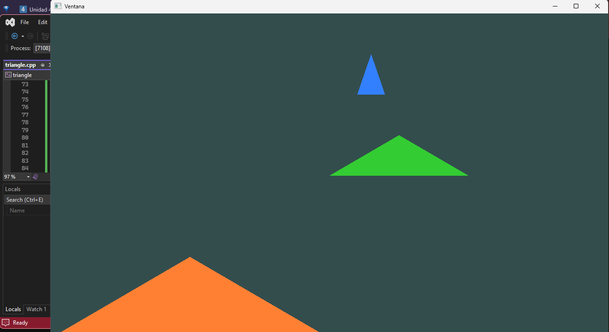
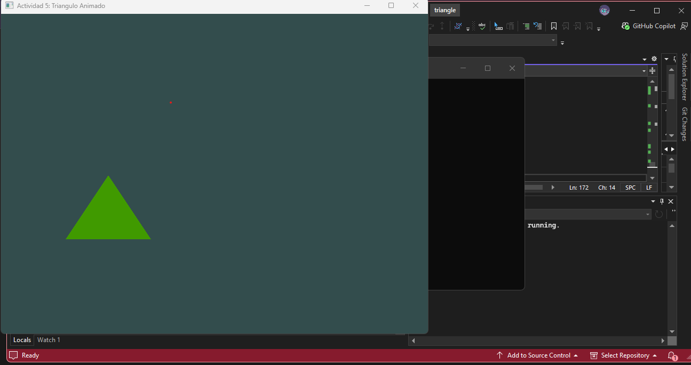

# Actividad 1

- ¿Qué hace cada fragmento de código que construye el shader?
- ¿Para qué se usa el parámetro `unsigned`?
- ¿Qué hace `GLAD`?

# Actividad 2

## GLFW
Es una biblioteca de funciones que se encarga de manejar el contexto de OpenGL en el programa y permite implementar su funcionalidad creando ventanas, recibiendo inputs de teclado y mouse, etc.

## opengl32.lib
Es una biblioteca que viene por defecto con Windows que permite inicializar el módulo de OpenGL y habilita sus funciones básicas.

## GLAD
Biblioteca que contiene funciones más avanzadas y completas de OpenGL que se pueden utilizar en tiempo de ejecución.

## GLM
Biblioteca de funciones matemáticas que permite manejar transformaciones gráficas con vectores y matrices con OpenGL.

## Drivers de GPU
Se utilizan con la biblioteca GLAD para para ejecutar las funciones complejas de forma más eficaz y potente.

# Actividad 3
## Punto 1

Al modificar le tamaño del viewport donde se dibuja el triángulo, este se hace más grande o pequeño si se multiplican o dividen sus valores de tamaño respectivamente.

- **Dividido por 2**

- **Dividido por 4**

- **Multiplicado por 2**

## Punto 2
Para poder trabajar con OpenGL, lo primero es configurar su 'estudio' para que la GPU pueda graficar en esta. Esto se hace primero llamando a la biblioteca **GLFW** que es la que maneja los eventos y espacio de memoria necesarios para que la instancia de OpenGL pueda funcionar correctamente. Luego, se tienen que configurar sus espacios de **framebuffer** y **viewport**. *Framebuffer* es la que habilita el espacio de dibujo a OpenGL para que se vea visualizar en pantalla, y *viewport* es la ventana que permite ver lo que se dibujó en el framebuffer, y este se ve afectado dependiendo del tamaño asignado al viewport, porque se puede ver estirado, achicado o fuera de la ventana.

## Punto 3
**1)** Se dibuja en el framebuffer una línea en lugar de un triángulo. En ese caso se debe definir que se dibujan 2 vectores en lugar de 3 para una línea.

**2)** Dibuja en este caso puntos, los cuales solo tienen un vértice (el punto).

**3)** Si es para el triángulo **no lo dibuja** porque no toma en cuenta el tercer vértice para renderizarlo, y sin todos los vértices el triángulo no se dibuja. Para `GL_LINES` si se renderiza una línea porque solo necesita 2 de los vértices.

**4)** En este caso no se ven afectados los renderizados porque los vértices a renderizazr son menores a los que lee el método, por lo que se renderizan igualmente.

## Punto 4

**1)** El *contexto OpenGL* es la funcionalidad que configura el entorno de trabajo para OpenGL.

**2)** La biblioteca *GLFW* permite utilizar varios métodos que modifican y establecen parámetros de graficamiento para utilizar OpenGL al máximo potencial.

**3)** Porque se necesita establecer un entorno de trabajo con parámetros establecidos para que al llamar OpenGL este sepa cómo utilizar la GPU para dibujar correctamente.

**4)** El *framebuffer* se encarga de indicar a OpenGL dónde debe graficar los shaders y vértices definidos para luego mostrarlos en la pantalla establecida. Se relaciona en parte a las primeras 2 unidades del curso como el `backend` del programa que hace que podamos ver lo que dibuja OpenGL mientras este realiza el proceso que asigna el espacio definido.

**5)** *Viewport* es la ventana de visualización asignada para mostrar el gráfico del llamado de OpenGL, mientras que *framebuffer* usa el viewport como medio de depliege del gráfico de OpenGL que se asignó a este, y se ve afectado por las propiedades definidas en el viewport.

**6)** La *GPU* y sus drivers son las encargadas de recibir las instrucciones de dibujo de la API de OpenGL para luego procesar los shaders necesarios para graficarlo.

**7)** El *Vsync* no es necesario de usar pero beneficioso si al depurar un programa con gráficos detallados estos se ven con 'cortes', los cuales son arreglados con Vsync al sincronizar la frecuencia de actualización de los gráficos con los de la pantalla que los está visualizando. Si la imagen es estática, sobra usar el Vsync porque no se podrían generar cortes por desincronización de la imagen con la tasa de cuadros de la pantalla en primer lugar.

**8)** *OpenGL Legacy* son las versiones por defecto y antiguas que vienen incluídas ocn el sistema operativo de Windows. La diferencia entre estas versiones y las modernas es que vienen con funcionalidades descontinuadas que no son necesarias para el procesamiento de gráficas y las modernas son más moldeables para el desarrollo con librerías que amplifican su funcionalidad.

**9)** El *shader program* es el que permite a OpenGL definir cómo graficar los vértices y fragmentos del programa para poder visualizarlos. Sin este no se podría graficar correctamente.

**10)** `setupTriangle()` define la posición de los vértices a renderizar y los buffers con la información necesaria para que OpenGL los pueda utilizar para que la GPU grafique el triángulo en el framebuffer.

**11)** No es necesario, aunque solo cuando se necesita renderizar una vez el gráfico en el programa y el viewport no se va a modificar durante el tiempo de ejecución del programa.

**12)** Es importante implementar ese método para que se pueda visualizar la imagen del gráfico del *framebuffer* en el viewport. Si no se llama no se ve nada (queda en blanco), porque la imagen queda en el fondo dentro del framebuffer en espera pero nunca se pasa a la pantalla.

# Actividad 4
## Punto 1
La *CPU* procesa uno a uno los datos del gráfico a procesar (asumiendo que no tiene procesador gráfico integrado), dibujando iteradamente los arreglos de shaders, lo cual es lento y de baja calidad. La *GPU* en cambio procesa cada vértice de la gráfica al mismo tiempo para plasmar la imagen en alta calidad y  mayor rapidez debido a la alta capacidad de procesamiento vectorial que tiene.

## Punto 2
**1)** - Vertex Shading: Se encarga de renderizar las caras de los objetos que se puedan ver en la pantalla del jugador. Cada vértice visible se procesa a través del espacio utilizando sus coordenadas en el espacio y de la cámara para calcular cómo se proyecta cada cara en la pantalla.

- Rasterización: Se encarga de pulir las caras proyectadas calculando el espacio utilizado por los píxeles de las caras para que las texturas y colores se vean adecuadamente, y verifica cuales caras se grafican de acuerdo a su valor de Z-Buffer para evitar procesar caras no visibles en la cámara.

- Fragment Shading: Se encarga de aplicar sombras a las texturas de acuerdo a su posición relativa a las fuentes de luz presentes en la escena.

**2)** El pipeline programable de OpenGL permite a los desarrolladores indicar cómo se comporta el proceso de renderizado de 3D a 2D en la escena, dando más libertad de implementación y de instrucción al programa para optimizar el uso de recursos.

**3)** La **rasterización** lee las caras de los objetos en la escena, y pasa a asignar cada parte de cada cara en *segmentos* que se convierten en píxeles para que puedan ser vistos en pantalla.

**4)** Los **fragmentos** son los segmentos de píxeles que forman la cara del objeto que se está renderizando en la escena.

**5)** El **z-buffer** se encarga de indicar al pipeline la ubicación espacial y la distancia a la cámara de cada segmento. Esto es útil para saber qué segmentos están superpuestos o sobrepuestos de otros para solamente renderizar los que están más cercanos y visibles a la cámara.

**6)** El **aliasing** ocurre cuando el pixel se pinta en su totalidad de acuerdo al segmento que está mostrando, generando objetos con bordes dentados. El **anti-aliasing** ayuda a reducir el efecto del aliasing al agregar más puntos de sampleo para fraccionar las partes que se renderizan sobre cada píxel, suavizando la imagen del objeto.

**7)** No es estrictamente necesario, pero si la escena aplica efectos de iluminación, el objeto se verá igual sin importar el estado de la escena. El **fragment shader** y la **iluminación** se relacionan porque de acuerdo a la iluminación presente y la función matemática que se aplica a cada segmento, se pueden lograr efectos visuales más realistas de acuerdo a la iluminación presente.

**8)** Si hay múltiples fuentes de iluminación, la **gpu** tiene que aplicar procesos de renderizado y sombreado para cada segmento para cada fuente de luz, lo que implica múltiples pipelines que tiene que manejar haciendo que tenga una carga de trabajo mayor.

## Punto 3

**1)** - Primero hay que definir los vértices del triángulo que van a estar, sus posiciones y atributos antes de asignarles el renderizador (VAO).
- Al definir los vértices, estos pasan por el **vertex shader** que se encarga de graficarlos en el espacio de renderizado establecido (VBO).
- Para graficar el triángulo, se ejecuta el shader de fragmentos que revisa cada píxel dentro del triángulo definido espacialmente por los vértices y les aplica los atributos especificados en el método.

**2)** Para usar un shader en OpenGL, se debe indicar primero cuales son los vértices que se quieren definir en el espacio y cuales van a ser los segmentos que se verán renderizados en el pipeline y se mostrarán en el volumen de la cámara. Al hacer esto, se deben desvincular los VAO del VBO para evitar que todos los comandos enviados a OpenGL se apliquen al objeto.

## Punto 4

**Ejecución del programa con los 3 shaders**

## Actividad 5
**1) Código triángulo interactivo**
--> Unidad4-ProgramaciónGráficaModerna\actividad5_trianguloInteractivo.cpp

**2) Captura Código en Funcionamiento**

**3)** El proceso de normalización consiste en tomar las coordenadas absolutas en píxeles del mouse entregadas por el sistema operativo y convertirlas en una escala unificada, independientemente de la resolución de la ventana. Primero se utiliza la función `glfwGetCursorPos` para devolver la posición (x, y) del cursor. Luego se divide `x` por el ancho de la ventana y `y` por el largo, luego para transformarlos en un valor entre 0 y 1.Finalmente, se utilizan condicionales para evitar que el cálculo se salga de rango si el usuario mueve el cursor por fuera del borde de la ventana de renderizado.

Estos valores brutos normalizados de [0.0, 1.0] son ideales para operaciones de color, ya que los fragment shaders de OpenGL esperan parámetros de color RGBA exactamente en este rango numérico.

**4)** El NDC es un sistema de coordenadas donde el centro de la pantalla es exactamente el origen (0.0, 0.0). Los ejes se extienden desde `-1.0` a `1.0` en todas las direcciones tridimensionales (X, Y, Z). Todo lo que caiga fuera de la "caja" de -1 a 1 es recortado por la tarjeta gráfica y no se dibuja.

Para el *eje `x`*, La fórmula `x * 2 - 1` toma el rango de pantalla [0.0, 1.0] calculado anteriormente y lo estira. Un 0.0 (extremo izquierdo) se convierte en -1.0. Un 0.5 (mitad) se convierte en 0.0 (centro NDC). Un 1.0 se convierte en 1.0. 

Para el *eje `y`*, la fórmula 1 - y * 2 realiza la misma operación, pero con una inversión de eje. Al restar sobre 1, invertimos físicamente las coordenadas del mouse para que los movimientos físicos hacia arriba correspondan a incrementos positivos en el espacio de OpenGL.